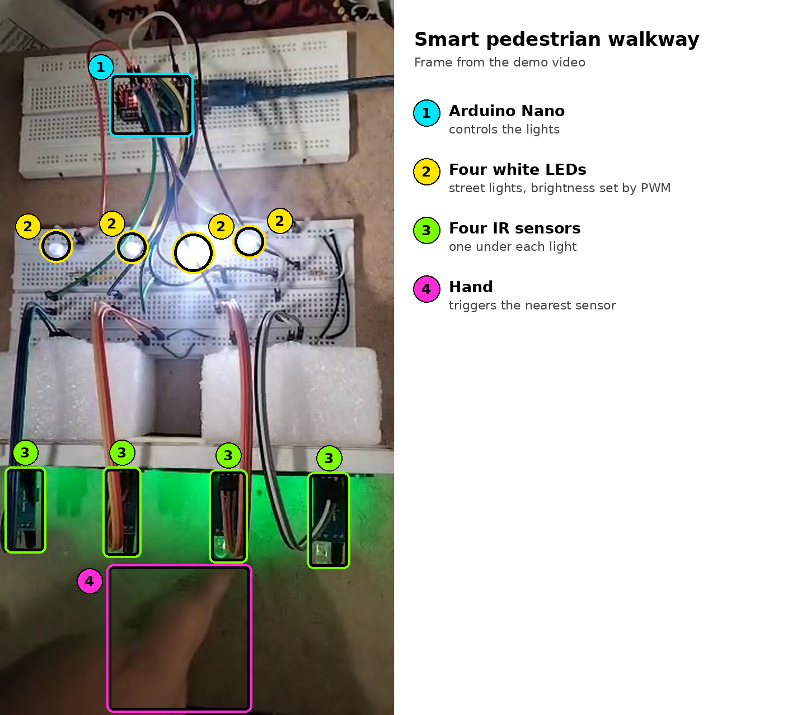
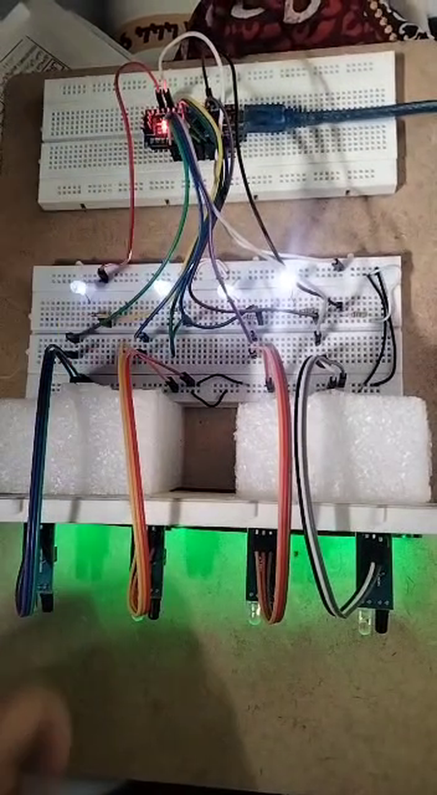

# Smart Pedestrian Walkway (IR Sensors + Arduino Nano)

**Communication Systems Lab · Institute of Space Technology, Islamabad**

A smart street-lighting system for a pedestrian walkway. Four LEDs act as street lights and glow dimly while the walkway is empty. When a pedestrian passes one of four infrared (IR) sensors, the light at that position fades up to full brightness, then fades back down once the person has moved on. Lighting only where it is needed saves energy while keeping the path lit for the person walking.

> **About the code.** The hardware demonstration was built and recorded in Fall 2022. The pin assignment in the sketch is the one used in this repository, so check it against your own wiring.

---

## Demonstration



*Frame from the demo video: the hand at the third sensor makes the nearest light bright.*



*Between detections, the lights stay at a low brightness.*

---

## How it works

```
IR sensor (x4)  →  Arduino Nano  →  PWM output (x4)  →  White LEDs (x4)
detects a person     decides the       sets the            street lights
                     brightness        brightness
```

1. Each IR sensor sits next to its own street light and watches the space in front of it.
2. The Arduino Nano reads the four sensor outputs continuously.
3. When a sensor detects a person, the Nano ramps that light's PWM duty cycle up to full brightness.
4. The light stays bright for about 1.5 seconds after the last detection, so it does not flicker while someone walks past.
5. After that it fades slowly back to the dim idle level.

Each light is controlled independently, so only the lights near the pedestrian brighten.

---

## How the IR sensor works

The sensor module contains an **IR LED (transmitter)** and an **IR photodiode (receiver)** side by side, facing the same direction.

- The transmitter sends out infrared light, which is invisible to the eye.
- With nothing in front of the sensor, very little light returns to the receiver.
- When an object such as a person comes close, it **reflects** the infrared light back into the receiver.
- The receiver converts the reflected light into a small voltage, and a **comparator** on the module compares that voltage with a threshold set by a small potentiometer.
- When the voltage passes the threshold, the digital output changes state (usually to LOW), and the Arduino reads this as "object detected".

Turning the potentiometer on the module changes the threshold, and with it the detection distance.

This is a simple optical link: a transmitter sends a signal, the path carries it, and a receiver detects it, with a threshold deciding whether the signal is present.

---

## Concepts demonstrated

| Concept | Where it appears |
|---|---|
| Infrared transmission and reflection | The IR LED and photodiode pair detect a person by reflected light |
| Threshold detection (comparator) | The module's comparator turns an analog reflection level into a digital output |
| Sensor interfacing | Four digital sensor outputs read by the Arduino Nano |
| Pulse-width modulation (PWM) | `analogWrite` sets LED brightness by changing the duty cycle |
| Multi-channel control | Four sensor and LED pairs handled independently in one loop |
| Non-blocking timing | `millis()` handles the hold time and fading without using `delay()` |
| Energy-aware design | Lights stay dim until needed, saving power |

---

## Components

| Component | Quantity | Notes |
|---|---|---|
| Arduino Nano | 1 | Controller, powered over USB |
| IR obstacle sensor modules | 4 | IR LED, photodiode and comparator, with an adjustable threshold |
| White LEDs | 4 | Street lights |
| Resistors | 4 | One per LED, for current limiting |
| Breadboards and jumper wires | | Prototype assembly |

---

## Wiring

| Light position | IR sensor pin | LED pin (PWM) |
|---|---|---|
| 1 | D2 | D3 |
| 2 | D4 | D5 |
| 3 | D7 | D6 |
| 4 | D8 | D9 |

Each LED connects from its PWM pin through a resistor to ground. Each sensor module connects to 5 V, ground and its digital output pin. Change the pin lists at the top of the sketch if your wiring is different.

---

## Behaviour

| Situation | Light |
|---|---|
| No one near the sensor | Dim (idle level) |
| Person at the sensor | Fades quickly to full brightness |
| Person moves away | Stays bright for about 1.5 s, then fades slowly back to dim |

The brightness levels, hold time and fade speeds are constants at the top of the sketch, so they can be tuned.

---

## Running the code

1. Open `smart_pedestrian_walkway/smart_pedestrian_walkway.ino` in the Arduino IDE.
2. Select **Arduino Nano** and the correct processor and port.
3. Upload the sketch.
4. If the lights behave the wrong way round (bright when idle, dim when a person is present), set `SENSOR_ACTIVE_LOW` to `false`.

---

## Limitations and possible improvements

- **Range and lighting.** IR reflection depends on distance, surface colour and ambient light, so bright sunlight or dark clothing can change the detection range.
- **Direction.** The system detects presence only, not walking direction. Using neighbouring sensors in sequence could light the path ahead of a walker.
- **Ambient light.** A light sensor (LDR) could keep the lights off during the day.
- **Scale.** More sensors and LEDs can be added, or LED strips driven through transistors for higher current.

---

## Repository contents

```
smart-pedestrian-walkway/
├── README.md
├── arduino_code/
│   └── smart_pedestrian_walkway.ino
└── images/
    ├── hardware_annotated.png
    └── hardware_lights_dim.png
```
